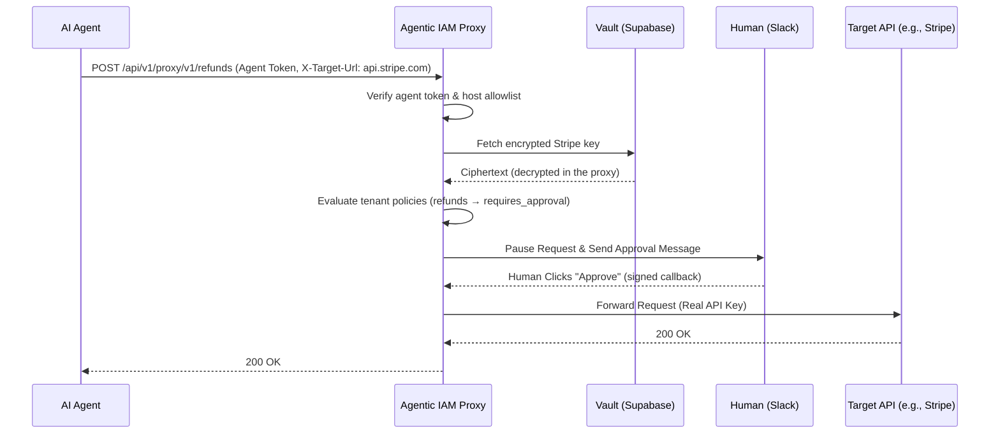
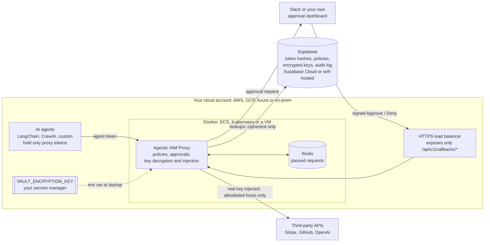

# Agentic IAM Proxy

**Stop giving your AI agents raw API keys.** Agentic IAM Proxy is a local, zero-trust gateway that forces a human-in-the-loop Slack approval before your agent executes high-risk actions.

Your agent gets a revocable proxy token instead of a real API key. Every call goes through the proxy, which checks where it is going, asks a human in Slack before risky actions, and only then attaches the real credential from an encrypted vault. The agent never sees the key.



## 5-Minute Quickstart

**You need:** Docker, a [Supabase](https://supabase.com) project, the [Supabase CLI](https://supabase.com/docs/guides/cli), and (for approvals) a Slack app, see [Slack setup](#slack-setup).

```bash
# 1. Clone
git clone https://github.com/tusharfc/agentic-iam-proxy.git
cd agentic-iam-proxy

# 2. Configure: fill in SUPABASE_URL, SUPABASE_SERVICE_ROLE_KEY, VAULT_ENCRYPTION_KEY and the SLACK_* values
cp .env.example .env
python3 -c "import base64, os; print(base64.urlsafe_b64encode(os.urandom(32)).decode())"   # -> VAULT_ENCRYPTION_KEY

# 3. Create the database tables in your Supabase project
supabase link --project-ref <your-project-ref>
supabase db push

# 4. Start the proxy (http://localhost:8000) and Redis
docker-compose up -d --build

# 5. Create your tenant and admin token (shown once, so save it)
docker-compose exec proxy python bootstrap.py
```

Prefer running the script on your host? `pip install -r requirements.txt && python bootstrap.py` works too.

### Give an agent access to Stripe

```bash
ADMIN=<admin token from bootstrap.py>

# Create an agent: the response contains its token, shown exactly once
curl -s -X POST localhost:8000/api/v1/manage/agents \
  -H "X-Management-Token: $ADMIN" -H "Content-Type: application/json" \
  -d '{"agent_name": "billing-bot"}'

# Store the real Stripe key in the vault (encrypted at rest, never returned)
curl -s -X POST localhost:8000/api/v1/manage/vault/keys \
  -H "X-Management-Token: $ADMIN" -H "Content-Type: application/json" \
  -d '{"service_name": "stripe", "raw_api_key": "sk_test_..."}'

AGENT=<agent token>

# Low-risk call: forwarded immediately, with the real key swapped in
curl -s localhost:8000/api/v1/proxy/v1/customers \
  -H "Authorization: Bearer $AGENT" -H "X-Target-Url: https://api.stripe.com"

# High-risk call: pauses until someone clicks Approve or Deny in Slack
# (needs a requires_approval policy, see "Policies" below)
curl -s -X POST localhost:8000/api/v1/proxy/v1/refunds \
  -H "Authorization: Bearer $AGENT" -H "X-Target-Url: https://api.stripe.com" \
  -d charge=ch_123
```

Point your agent framework's HTTP client at `http://localhost:8000/api/v1/proxy/<path>` with the `X-Target-Url` header, and give it the agent token instead of the real key.

## How it Works

1. **Agent Token.** The agent sends its request to the proxy with its own token (`Authorization: Bearer ...`) and the real destination in `X-Target-Url`. The proxy looks up the SHA-256 hash of the token to find the tenant. Only hashes are stored.
2. **Egress check.** The destination host must be on the approved service allowlist (`api.stripe.com`, `api.github.com`, `api.openai.com`, `slack.com`), over HTTPS. Anything else gets `403`. Destinations that resolve to private or internal addresses are always blocked.
3. **Policy check.** The tenant's rules in `tenant_policies` are evaluated in priority order (see [Policies](#policies)). `deny` returns `403` immediately.
4. **Vault lookup.** The tenant's key for that service is fetched and decrypted (Fernet, `VAULT_ENCRYPTION_KEY`). If there is no key, the request fails right away, before any human is asked.
5. **Redis Pause.** Requests whose policy is `requires_approval` post an Approve/Deny message to Slack and wait on a Redis channel. The agent's request stays open. A signed Slack callback wakes it. Denied or timed-out requests (`HITL_TIMEOUT_SECONDS`, default 300) get `403` and are never executed.
6. **Vault Swap.** The agent's token is stripped and the real key is injected as `Authorization: Bearer <key>`. The request is forwarded and the response streams back to the agent.

Decrypted keys are never logged, returned, or written to audit logs.

### Policies

Each row in `tenant_policies` has a `priority` (lowest first), a `method` (`GET`, `POST`, ... or `*`), a `url_pattern` regex, and an `action`: `allow`, `deny` or `requires_approval`. The first matching rule decides. If nothing matches, the request is allowed.

```sql
insert into tenant_policies (tenant_id, name, priority, method, url_pattern, action) values
  ('<tenant-id>', 'Block customer deletion',          10, 'DELETE', '^https://api\.stripe\.com/v1/customers/', 'deny'),
  ('<tenant-id>', 'Require approval for refunds',     20, 'POST',   '^https://api\.stripe\.com/v1/refunds',    'requires_approval'),
  ('<tenant-id>', 'Require approval for any delete', 100, 'DELETE', '.*',                                         'requires_approval');
```

- **What is matched:** patterns are matched against `scheme://host/path`, without the query string, so an agent can't add `?x=...` to trigger or dodge a rule. Encoded characters (`%66` → `f`) and `..` are resolved first, so `/v1/re%66unds` still matches `refunds`. Anchor patterns with `^` for exact control.
- **Fails closed:** an invalid pattern, or one that takes too long to match, denies the request. If policies can't be loaded, the agent gets `503`.
- **Tie-breaking:** at equal priority, the stricter action wins (`deny` > `requires_approval` > `allow`).

### Slack setup

1. Create a Slack app and enable **Incoming Webhooks**. Put the webhook URL in `SLACK_WEBHOOK_URL`.
2. Enable **Interactivity** with Request URL `https://<public-host>/api/v1/callbacks/slack`. For local testing, expose port 8000 with a tunnel such as `ngrok http 8000`.
3. Copy **Basic Information > Signing Secret** into `SLACK_SIGNING_SECRET`. Unsigned callbacks are rejected.

### Headless approvals (your own dashboard)

Set `CUSTOM_WEBHOOK_URL` and `CUSTOM_WEBHOOK_SECRET` to receive approval requests in your own backend instead of, or alongside, Slack. When a request needs approval, the proxy POSTs:

```json
{"approval_token": "...", "action": "requires_approval", "target_url": "https://api.stripe.com/v1/refunds",
 "method": "POST", "tenant_id": "...", "expires_at": 1762430400}
```

The body is signed Stripe-style: `X-Signature: t=<unix time>,v1=<hex HMAC-SHA256 of "<t>.<raw body>">`. Verify it before trusting the payload:

```python
parts = dict(p.split("=", 1) for p in request.headers["X-Signature"].split(","))
expected = hmac.new(SECRET.encode(), f"{parts['t']}.".encode() + raw_body, hashlib.sha256).hexdigest()
assert hmac.compare_digest(expected, parts["v1"]) and abs(time.time() - int(parts["t"])) < 300
```

Then record the human's decision from your dashboard's backend, authenticated with a management token from the same tenant:

```bash
curl -X POST localhost:8000/api/v1/callbacks/approve \
  -H "X-Management-Token: $ADMIN" -H "Content-Type: application/json" -d '{"approval_token": "..."}'
# or /api/v1/callbacks/deny  ->  {"status": "success", "action": "approved"}
```

- **Two credentials, both required.** The approval token is random, single-use, expires with the request, and the proxy stores only its hash. The management token must belong to the tenant that owns the request, so another tenant can neither use nor burn your tokens. Keep both server-side.
- **Errors:** a missing or invalid management token returns `401`; an unknown, used, expired or other-tenant approval token returns `404`; a request that was already decided (for example in Slack) or timed out returns `409`.
- **Delivery failures:** if the webhook can't be delivered and no other channel succeeded, the agent gets `503` immediately instead of waiting for a timeout.

### Configuration

| Variable | Purpose |
|---|---|
| `SUPABASE_URL`, `SUPABASE_SERVICE_ROLE_KEY` | Database. Use the service-role key (server-side only), not the anon key. |
| `VAULT_ENCRYPTION_KEY` | Encrypts stored API keys. If you lose it, every stored key becomes unreadable. |
| `SLACK_WEBHOOK_URL`, `SLACK_SIGNING_SECRET` | Approval messages and signed button callbacks. |
| `CUSTOM_WEBHOOK_URL`, `CUSTOM_WEBHOOK_SECRET` | Signed headless approval webhooks for your own dashboard (https). |
| `HITL_TIMEOUT_SECONDS` | How long a high-risk request waits for a decision. Your agent's HTTP timeout must be longer. |

The full list, with comments, is in [`.env.example`](.env.example).

## Deploy in Your Own Cloud (BYOC)

There is no hosted Agentic IAM service in the request path. You run the proxy and Redis next to your agents, in your own AWS, GCP or Azure account or on-prem, with `docker compose`, ECS, Kubernetes or a plain VM.



| What | Where it lives |
|---|---|
| Real API keys, decrypted | Only in the proxy's memory, while forwarding a request |
| `VAULT_ENCRYPTION_KEY` | Your environment or secrets manager. Supabase never sees it, so it can't decrypt your keys |
| Encrypted keys, token hashes, policies, audit log | Supabase. [Self-host Supabase](https://supabase.com/docs/guides/self-hosting/docker) to keep this inside your network too |
| Paused requests | Redis, inside your network |
| Approval message: agent, workspace, method and endpoint | Slack or your webhook. Request bodies and query strings are never sent |

The only outbound connections the proxy makes are to Supabase, your approval channel, the allowlisted APIs and, if you set an Enterprise license key, `api.polar.sh` for license checks.

**Recommended hardening:**
- Block your agents' direct internet egress, so the proxy is their only route out.
- Keep port 8000 private, and expose only the Slack callback route publicly.
- Load `.env` values from your secrets manager instead of a file.

## Open-Core Disclaimer

- **Core proxy: [GNU AGPLv3](LICENSE).** Everything outside `ee/` and `clients/` (the proxy, vault, Slack approvals, management API) is free and open source. If you modify it and offer it to others over a network, the AGPLv3 requires you to publish your changes.
- **Enterprise Edition: commercial license.** SSO/SAML and compliance-grade audit logs live in [`ee/`](ee/), are **not** open source, and require an active Enterprise subscription. See [`ee/COMMERCIAL_LICENSE.md`](ee/COMMERCIAL_LICENSE.md).
- **Client libraries: [Apache-2.0](clients/python/langchain-agentic-iam/LICENSE).** The SDKs in [`clients/`](clients/) are permissively licensed, so importing them into your agent code places no AGPLv3 obligations on it.
- **Can't use the AGPLv3?** The core is also available under a commercial license. See [`COMMERCIAL_LICENSE.md`](COMMERCIAL_LICENSE.md).

| Path | License |
|---|---|
| everything not listed below | [AGPL-3.0-only](LICENSE) or [commercial](COMMERCIAL_LICENSE.md) |
| `ee/` | [Proprietary, Enterprise subscription](ee/COMMERCIAL_LICENSE.md) |
| `clients/python/langchain-agentic-iam/` | [Apache-2.0](clients/python/langchain-agentic-iam/LICENSE) |
| `clients/python/crewai-agentic-iam/` | [Apache-2.0](clients/python/crewai-agentic-iam/LICENSE) |

Copyright (c) 2026 Tushar Kumar.

## Development

```bash
python -m venv .venv && .venv/bin/pip install -r requirements-dev.txt
.venv/bin/python -m pytest -q
```

Contributions are welcome under the project's Contributor License Agreement, which keeps dual licensing possible.
